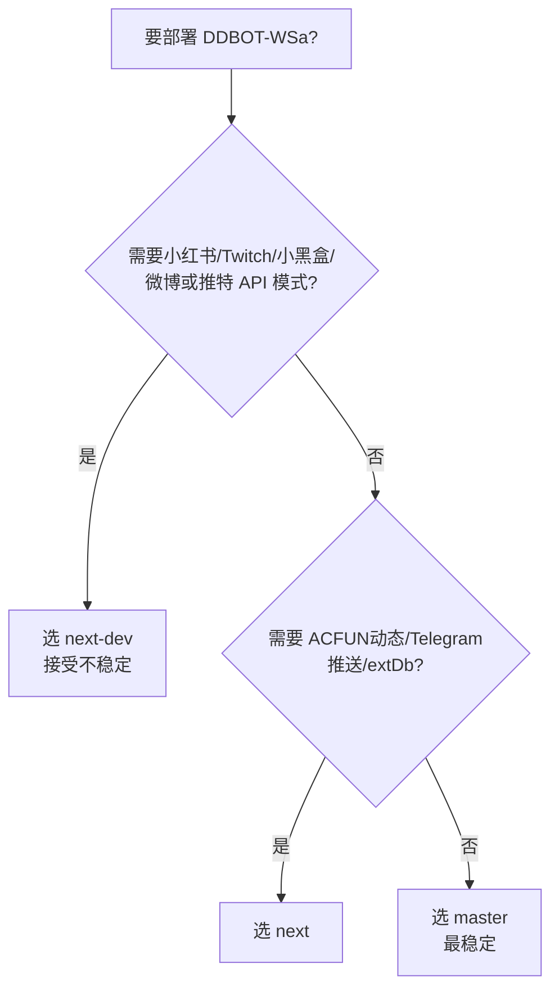

# 版本与分支

DDBOT-WSa 同时维护多个分支，功能与稳定性各有侧重。本页帮你选择适合自己的版本。

---

## 分支概览

| 分支 | 定位 | 稳定性 | 推荐场景 |
|------|------|--------|---------|
| **master** | 稳定分支，已验证功能 | 高 | 生产部署、新手使用 |
| **next** | 下一版候选，新功能 + 修复 | 中 | 尝鲜新功能、跟进开发 |
| **next-dev** | 开发分支，最前沿但不稳定（含 [Web 管理面板](webui.md)） | 低 | 开发者、测试新订阅源 |
| **lite-reimpl** | DDBOT-Lite 证据驱动重实现（**只读参考分支**） | 参考 | 研究 / 对照，**不推荐生产** |

本文档站内容以 **master** 为准。`next` / `next-dev` 的新增内容见下文。

---

## master（稳定分支）

当前文档主要描述的版本。内置 9 个订阅源：

- B 站（live / news）
- 斗鱼、虎牙、ACFun、YouTube、微博、TwitCasting
- 推特（实验）、抖音（测试）

详见 [订阅源总览](../sources/index.md)。

---

## next 分支的新增内容

`next` 是 master 之后的候选版本，相对 master 的主要变化：

### 订阅源增强

- **ACFun 动态推送**：除了原有的直播推送，新增动态（news）类型，支持配置 ACFUN 账号（`account` / `password` / `authKey` / `acPassToken`）
- **微博重构**：
    - 改用 EmitQueue 按间隔轮询（不再用旧的 `fresh()` 机制）
    - 支持两种运行模式：`guest`（访客）/ `login`（登录）；`api`（外部 API）模式为 `next-dev` 新增
    - SUB 过期检测与自动 Cookie 恢复（此能力为 `next-dev` 新增，`next` 不含）
    - 兼容微博访客 JSON 字段差异
- **推特**：
    - 保持 `mirror`（nitter 镜像）模式
    - 生成的配置模板里出现了 `twitter.unsub: false`，但 `next` 的代码并不读取该键，实际不生效；取关逻辑是 `next-dev` 新增的
    - `api`（Twitter API + cookie）模式为 `next-dev` 新增，`next` 不含
- **抖音**：重构已推送推文过滤，新增 `news` 类型与 `sessionId` cookie
- **B 站**：直播分区数据改为被动按需更新
- **YouTube**：新增模板支持（live / news 通知模板）；Shorts 支持为 `next-dev` 新增，`next` 不含

### 框架改进

- **StateManager**：为 EmitQueue 添加站点级别的 `interval` 配置支持（每个订阅源可独立设间隔）
- **Telegram 推送**：支持把推送同步到 Telegram（`telegram.enable`）。`next` 提供独立的 `telegram.proxy.enable` / `telegram.proxy.url` 代理配置；`next-dev` 改为走**全局代理池**，不再读取单独的代理配置
- **扩展数据库**：新增 `extDb`，可选独立于 `.lsp.db` 的扩展数据库（`extDb.enable` / `extDb.path`）

### 配置差异（相对 master）

`next` 分支的 `application.yaml` 新增/变化字段：

```yaml
acfun:                  # 新增 ACFUN 账号配置
  account:
  password:
  authKey:
  acPassToken:
  unsub: false
  interval: 25s
  onlyOnlineNotify: false

twitter:                # next 仅 mirror（nitter）模式；api 模式见下方 next-dev
  baseUrl:
    - "https://nitter.net/"
  interval: 30s
  userAgent:
  unsub: false

douyin:                 # 新增 news 类型与 sessionId
  acSignature:
  acNonce:
  sessionId:
  userAgent:
  interval: 30s

weibo:                  # 重构为 guest / login 两种模式
  mode: guest           # guest / login
  sub:
  qrlogin: true

extDb:                  # 扩展数据库（可选，独立于 .lsp.db）
  enable: false
  path: ".ext.db"

telegram:               # Telegram 推送
  enable: false
  token: ""
  proxy:                # next：独立的代理配置（http/https/socks5/socks5h）
    enable: false
    url: ""
  endpoint: ""
```

---

## next-dev 分支的新增内容

`next-dev` 是最前沿的开发分支，功能上覆盖 `next` 的内容（分支历史上并非直接包含关系），并额外新增：

### 新增订阅源

| 订阅源 | site | 类型 | 说明 |
|--------|------|------|------|
| **小红书** | `xhs` | live / news | 需配置 cookies（a1 等），含加密模块 |
| **Twitch** | `twitch` | live | 需注册 Twitch 应用获取 clientId/clientSecret |
| **小黑盒** | `xhh`（配置键 `heybox.*`） | news | 自动生成 smidV2，无需配置 |

### 框架级变化

- **适配器抽象**：新增 `adapter` 配置，默认 `onebot-v11`，为未来支持更多协议预留
- **Web 管理面板**：内置网页管理端——初始化向导、仪表盘、订阅/权限/命令/模板管理、实时日志与推送记录、平台级启停。
  配置项 `admin.enable` / `admin.addr` / `admin.token`，详见 [Web 管理面板](webui.md)。
  该功能由 `webui-embed` 分支开发，已合入 `next-dev`。
- **YouTube Shorts 支持**：新增 Shorts 推送，带配置加固和测试
- **推特 API 模式**：新增 `twitter.mode: api`（缺省即 api）、`apiFetchMode`、推文自动翻译（`twitter.translate.*`）、`retweetFullText`、`queryIdRefreshInterval`
- **微博移动端 API**：新增移动端 API 响应 proto 定义及转换
- **模板兼容性修复**：`adapter.SenderInfo.Uin` 字段保留为 `UserID` 的别名，老模板无需修改

### next-dev 配置示例

```yaml
xhs:                    # 小红书
  cookies:
    a1: ""
    web_session: ""
    webId: ""
  interval: 15s
  onlyOnlineNotify: false

twitch:                 # Twitch
  clientId:
  clientSecret:
  interval: 30s
  onlyOnlineNotify: false

heybox:                 # 小黑盒
  x_xhh_tokenid:        # 可选，未配置时自动生成
  interval: 30s
  onlyOnlineNotify: false

adapter:
  mode: onebot-v11

admin:
  enable: false
  addr: "127.0.0.1:15631"
  token: ""

weibo:                  # next-dev 相对 next 额外新增：api 模式 / SUB 自动刷新 / SnapCast / Cookie 告警开关
  mode: api             # guest / login / api
  autorefresh: false
  apiModeBaseURL: "http://127.0.0.1:5000"
  snapcastURL: ""
  disableCookieAlert: true

twitter:                # next-dev：API 模式（缺省即 api）
  mode: api             # api（默认）/ mirror
  apiFetchMode: per_user   # home_timeline / per_user
  retweetFullText: false
  translate:
    enabled: false
    minInterval: 5s
    targetLang: zh
    batchWait: 15s
  queryIdRefreshInterval: 168h
  userTweetsQueryId:       # UserTweets API queryId（可选，默认自动获取）
  auth_token:
  ct0:
  bearerToken:
  queryId:
  screenName:

```

---

## lite-reimpl（只读参考分支）

`lite-reimpl` 是 [阿宇](https://github.com/why0209) 私有分支 **DDBOT-Lite** 的**证据驱动重实现**，作为一个**只读参考分支**存在，供研究与逐步移植，**不推荐用于生产**。

- **不是源码复制**：据该分支的 `NOTICE.md`，原作者因工作原因已放弃维护并自行删除原始源码，本分支全部代码以运行成品二进制为唯一依据重新实现
  （符号表 / 调用图 / 类型层 / `rodata` 字节级还原）。
- 已获原作者授权，许可证沿用 **AGPL-3.0**。
- 启用的平台：B 站（直播 / 动态）、微博、抖音、猫耳FM。
- **未做端到端生产验证**；已知差异见该分支根目录的 `NOTICE.md`。

---

## 如何选择



### 建议

- **新手 / 生产环境**：用 **master**，配合本文档
- **想用 ACFUN 动态、Telegram 推送、extDb**：用 **next**
- **需要小红书 / Twitch / 小黑盒、微博 API 模式、推特 API 模式**：用 **next-dev**，但要做好遇到 bug 的准备

---

## 切换分支

下载预编译版本时，在 [Releases](https://github.com/cnxysoft/DDBOT-WSa/releases) 选择对应产物：`master` 用 `fix_A0xx` 系列标签，`next-dev` 用 `Preview (next-dev)` 预发布；`next` 没有预编译产物，需要自行编译。

从源码编译：

```bash
# master
git clone -b master https://github.com/cnxysoft/DDBOT-WSa.git

# next
git clone -b next https://github.com/cnxysoft/DDBOT-WSa.git

# next-dev
git clone -b next-dev https://github.com/cnxysoft/DDBOT-WSa.git

cd DDBOT-WSa
make build
```

!!! warning "分支间不保证配置兼容"
    `next` / `next-dev` 的 `application.yaml` 字段比 master 多，从 master 升级到 next 时，新增字段按需添加即可（不填用默认值）。但从 next-dev 降回 master 可能丢失部分配置。

---

## 订阅源差异对照

| 订阅源 | master | next | next-dev |
|--------|:------:|:----:|:--------:|
| B 站 | ✅ | ✅ 分区按需更新 | ✅ |
| 斗鱼 | ✅ | ✅ | ✅ |
| 虎牙 | ✅ | ✅ | ✅ |
| ACFun | 直播 | 直播 + 动态 | 直播 + 动态 |
| YouTube | ✅ | ✅ 模板 | ✅ 模板 + Shorts |
| 微博 | ✅ 游客 | ✅ guest / login 两模式 | ✅ 三模式 + 告警、移动端 API |
| TwitCasting | ✅ | ✅ | ✅ |
| 推特 | ✅ mirror | ✅ mirror | ✅ mirror + api（默认 api） |
| 抖音 | ✅ live | ✅ live + news、sessionId | ✅ |
| 小红书 | ❌ | ❌ | ✅ |
| Twitch | ❌ | ❌ | ✅ |
| 小黑盒 | ❌ | ❌ | ✅ |

---

## 下一步

- [订阅源总览](../sources/index.md) - master 分支的订阅源说明
- [配置参考](../config/index.md) - master 配置字段
- [更新日志](../changelog.md) - 版本更新记录
