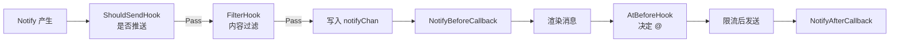

# 配置钩子

每个「群 × 订阅 id」可独立配置推送行为（@、过滤、推送开关）。插件可重写 `GroupConcernConfig` 注入自定义逻辑。

---

## Hook 链

推送时框架会依次调用一系列 Hook：



`ShouldSendHook` / `FilterHook` 在 `StateManager` 的 Dispatch 阶段执行（`lsp/concern/stateManager.go` 的 `filterNotify`）；`NotifyBeforeCallback` 及之后在框架消费 `notifyChan` 时执行（`lsp/notify.go`）。

| Hook | 作用 | 返回 |
|------|------|------|
| `ShouldSendHook` | 根据 Notify 自身状态决定是否推送（如上下播开关） | `HookResult` |
| `FilterHook` | 根据推送内容/文案决定是否过滤 | `HookResult` |
| `NotifyBeforeCallback` | 发送前回调，可修改 notify 状态 | - |
| `AtBeforeHook` | 决定是否 @、@谁 | `HookResult` |
| `NotifyAfterCallback` | 发送后回调，可缓存消息 | - |

`[next]` / `[next-dev]` 另有一个 `ShouldEnableHook`（控制增强推送是否启用，由 `IsExtendNotify` 调用），`master` 没有。

---

## 自定义 GroupConcernConfig

重写 `GetGroupConcernConfig`，返回自己的 config 类型：

```go
type GroupConcernConfig struct {
    concern.IConfig
    concern *Concern
}

func (g *GroupConcernConfig) FilterHook(notify concern.Notify) *concern.HookResult {
    hook := new(concern.HookResult)
    // 自定义过滤逻辑
    if shouldFilter(notify) {
        hook.Reason = "filtered by my rule"
        return hook
    }
    hook.Pass = true
    return hook
}

func NewGroupConcernConfig(g concern.IConfig, c *Concern) *GroupConcernConfig {
    return &GroupConcernConfig{g, c}
}
```

在 StateManager 上重写：

```go
func (s *StateManager) GetGroupConcernConfig(groupCode int64, id interface{}) concern.IConfig {
    return NewGroupConcernConfig(s.StateManager.GetGroupConcernConfig(groupCode, id), s.concern)
}
```

---

## HookResult

```go
type HookResult struct {
    Pass   bool
    Reason string
}
```

- `Pass = true` - 放行
- `Pass = false` - 拦截，`Reason` 会记录到日志

---

## 内置配置项

`IConfig` 已实现了这些配置（用户通过 `/config` 命令设置）：

### @相关（`config_at.go`）

- `CheckAtAll(type)` - 是否开启了 @全体
- `GetAtSomeoneList(type)` - 要 @的 QQ 号列表
- `SetAtSomeoneList(type, ids)` / `MergeAtSomeoneList(type, ids)` / `RemoveAtSomeoneList(type, ids)` / `ClearAtSomeoneList(type)` - 设置 / 合并 / 移除 / 清空 @成员

### 过滤（`config_filter.go`）

- `Empty()` - 是否未设过滤
- `Type` - 过滤类型（`FilterTypeType`/`FilterTypeNotType`/`FilterTypeText`）（`master`；`[next]` 起为 legacy 字段）
- `GetFilterByType()` / `GetFilterByText()` - 获取类型 / 文本过滤配置

!!! note "`[next]` 起的过滤配置结构"
    `[next]` / `[next-dev]` 把 `Type` / `Config` 改为 **legacy 字段**（仅用于兼容旧版本存储，见 `config_filter.go` 的注释），实际规则存在 `Rules` 中，用 `RulesNormalized()` 逐条遍历；`GetFilterByType()` / `GetFilterByText()` 会先把 legacy 字段迁移到 `Rules`，再返回首条对应类型的规则。`master` 仍是单组 `Type` / `Config`。

### 推送开关（`config_notify.go`）

- `CheckTitleChangeNotify(type)` - 标题变更推送
- `CheckOfflineNotify(type)` - 下播推送

你的 `FilterHook` 可基于这些配置决定是否放行。

---

## 范本：B 站动态过滤

参考 `lsp/bilibili/config.go` 的 `FilterHook`（`master`）：

```go
func (g *GroupConcernConfig) FilterHook(notify concern.Notify) (hook *concern.HookResult) {
    hook = new(concern.HookResult)
    switch n := notify.(type) {
    case *ConcernLiveNotify:
        hook.Pass = true
        return hook
    case *ConcernNewsNotify:
        if g.GetGroupConcernFilter().Empty() {
            hook.Pass = true
            return hook
        }
        switch g.GetGroupConcernFilter().Type {
        case concern.FilterTypeType, concern.FilterTypeNotType:
            typeFilter, err := g.GetGroupConcernFilter().GetFilterByType()
            // 把 typeFilter.Type 转成 DynamicDescType，与 n.Card.GetDesc().GetType() 比较；
            // 命中过滤条件时 hook.Reason = "filtered by TypeFilter"; return hook
        default:
            hook = g.IConfig.FilterHook(notify)
        }
        return hook
    default:
        hook.Reason = "unknown notify type"
        return hook
    }
}
```

!!! note "`[next]` 起的过滤配置结构"
    `[next]` / `[next-dev]` 改为遍历 `GetGroupConcernFilter().RulesNormalized()` 逐条规则，用 `rule.Type` + `rule.GetFilterByType()` / `rule.GetFilterByText()` 判断，不再是单字段 `FilterType`。完整实现见对应分支的 `lsp/bilibili/config.go`。

---

## NotifyBeforeCallback 示例

B 站用它在发送前设置 compactKey（联合投稿去重），按动态类型分支：

```go
func (g *GroupConcernConfig) NotifyBeforeCallback(inotify concern.Notify) {
    if inotify.Type() != News {
        return
    }
    notify := inotify.(*ConcernNewsNotify)
    switch notify.Card.GetDesc().GetType() {
    case DynamicDescType_WithVideo:
        notify.compactKey = notify.Card.GetDesc().GetBvid()
        err := g.concern.SetGroupCompactMarkIfNotExist(notify.GetGroupCode(), notify.compactKey)
        if localdb.IsRollback(err) {
            notify.shouldCompact = true  // 已存在，简化推送
        }
    case DynamicDescType_WithOrigin:
        // 转发动态：用原动态 id 做 compactKey
        notify.compactKey = notify.Card.GetDesc().GetOrigDyIdStr()
        err := g.concern.SetGroupCompactMarkIfNotExist(notify.GetGroupCode(), notify.compactKey)
        if localdb.IsRollback(err) {
            notify.shouldCompact = true
        }
    default:
        // 其他动态
    }
}
```

---

## NotifyAfterCallback 示例

发送后缓存消息，用于下次回复：

```go
func (g *GroupConcernConfig) NotifyAfterCallback(inotify concern.Notify, msg *message.GroupMessage) {
    if inotify.Type() != News || msg == nil || msg.Id == -1 {
        return
    }
    notify := inotify.(*ConcernNewsNotify)
    if notify.shouldCompact || len(notify.compactKey) == 0 {
        return
    }
    g.concern.SetNotifyMsg(notify.compactKey, msg)  // 缓存
}
```

!!! note "`[next-dev]` 的消息类型"
    `[next-dev]` 起消息类型改为 `*adapter.GroupMessage`（消息 ID 字段为 `msg.ID`）；`master` / `next` 是 `*message.GroupMessage`（字段 `msg.Id`），插件代码需按目标分支适配。

---

## AtBeforeHook

控制是否 @。B 站用它阻止「不安全启动状态」下 @：

```go
func (g *GroupConcernConfig) AtBeforeHook(notify concern.Notify) *concern.HookResult {
    hook := new(concern.HookResult)
    if g.concern != nil && g.concern.unsafeStart.Load() {
        hook.Reason = "unsafe start status"
        return hook
    }
    return g.IConfig.AtBeforeHook(notify)
}
```

---

## 下一步

- [keyset 与注册](keyset-register.md) - 注册与 key 规范
- [完整范本](example-walkthrough.md) - 真实实现走查
- [StateManager](statemanager.md) - 状态管理
