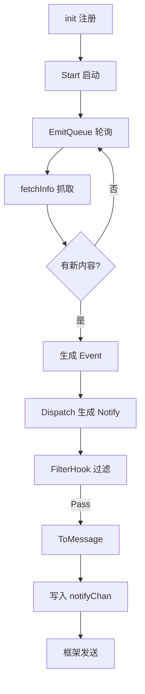

# 完整范本走查

本页以 DDBOT-WSa 内置的 **推特** 和 **抖音** 订阅源为范本，走查一个完整订阅源的实现。它们是较新的实现，结构清晰，适合作为参考。

---

## 目录结构

以推特为例（`lsp/twitter/`，下面只列主要文件；实际还有 `twitter_api.go`、`translate.go`、`rate_limiter.go`、`login_alert.go` 及各自的 `_test.go`）：

```
lsp/twitter/
├── init.go          # 注册 Concern + cookie 初始化
├── concern.go       # 实现 Concern 接口 + StateManager
├── config.go        # GroupConcernConfig（自定义 Hook）
├── extraKey.go      # 数据库 key 封装
├── fetchInfo.go     # 爬虫：解析推文 HTML（ParseResp）
├── notify.go        # Notify 实现：转成消息
├── model.go         # 数据结构
└── model_test.go    # 测试
```

---

## 1. init.go - 注册

```go
package twitter

import (
    "github.com/Sora233/MiraiGo-Template/config"
    "net/http/cookiejar"
    "github.com/cnxysoft/DDBOT-WSa/lsp/concern"
)

var (
    // 默认镜像；可被 twitter.BaseUrl 覆盖。UserAgent 此处省略，完整值见 lsp/twitter/init.go
    BaseURL   = []string{"https://nitter.tiekoetter.com/", "https://nitter.catsarch.com/"}
    UserAgent = "Mozilla/5.0 ..."
)

func init() {
    concern.RegisterConcern(newConcern(concern.GetNotifyChan()))
}

func setCookies() {
    ua := config.GlobalConfig.GetString("twitter.userAgent")
    url := config.GlobalConfig.GetStringSlice("twitter.BaseUrl")
    Cookie, _ = cookiejar.New(nil)
    if ua != "" {
        UserAgent = ua
    }
    if len(url) > 0 {
        BaseURL = url
    }
}
```

要点：

- `init()` 里注册，传入 `concern.GetNotifyChan()`
- 从 `config.GlobalConfig` 读取配置
- 初始化 cookie jar

---

## 2. concern.go - Concern 与 StateManager

```go
type StateManager struct {
    *concern.StateManager
    *ExtraKey
    concern *twitterConcern
}

type twitterConcern struct {
    *StateManager
    notify chan<- concern.Notify
}

const (
    Site   = "twitter"
    Tweets concern_type.Type = "news"
)

func (c *twitterConcern) Site() string { return Site }

func (c *twitterConcern) Types() []concern_type.Type {
    return []concern_type.Type{Tweets}
}

func (c *twitterConcern) ParseId(s string) (interface{}, error) {
    return s, nil  // 用户名是 string
}

func (c *twitterConcern) GetStateManager() concern.IStateManager {
    return c.StateManager
}
```

要点：

- 嵌入 `concern.StateManager` 和 `ExtraKey`
- `Site()` 返回唯一标识
- `Types()` 返回支持的类型
- `ParseId` 决定 id 类型（string/int64）

---

## 3. config.go - 自定义 Hook

```go
type GroupConcernConfig struct {
    concern.IConfig
    concern *twitterConcern
}

func (g *GroupConcernConfig) FilterHook(notify concern.Notify) *concern.HookResult {
    // 自定义过滤逻辑
    return concern.HookResultPass
}

func (t *StateManager) GetGroupConcernConfig(groupCode int64, id interface{}) concern.IConfig {
    return NewGroupConcernConfig(t.StateManager.GetGroupConcernConfig(groupCode, id), t.concern)
}
```

重写 `GetGroupConcernConfig` 注入自己的 config 类型，实现自定义过滤/推送逻辑。

---

## 4. extraKey.go - key 封装

```go
// lsp/twitter/extraKey.go
type ExtraKey struct{}

func (e *ExtraKey) UserInfoKey(keys ...interface{}) string {
    return buntdb.TwitterUserInfoKey(keys...)
}
```

把 key 生成逻辑封装在 `ExtraKey` 里（这里转发到 `lsp/buntdb` 的 key 函数），StateManager 嵌入后可直接用 `s.UserInfoKey(id)`。

---

## 5. 爬虫与 fresh - 抓取推文（concern.go / fetchInfo.go）

抓取与解析由 `GetTweets` 完成，再由 `freshNewsInfo` 转成 `Event`（`lsp/twitter/concern.go`）：

```go
func (t *twitterConcern) GetTweets(id string) ([]*Tweet, error) {
    // 1. 构建 URL（从 BaseURL 随机选一个镜像）
    Url := buildProfileURL(id)
    // 2. 请求页面并解压（requests.GetWithHeader）
    // 3. 解析 HTML，提取推文（lsp/twitter/fetchInfo.go 的 ParseResp）
    return tweets, nil
}

// freshNewsInfo 把推文转成 Event
func (t *twitterConcern) freshNewsInfo(ctype concern_type.Type, id interface{}) ([]concern.Event, error) {
    userId := id.(string)
    userInfo, err := t.FindOrLoadUserInfo(userId)
    if err != nil {
        return nil, err
    }
    newTweets, err := t.GetTweets(userId)
    if err != nil {
        return nil, err
    }
    var result []concern.Event
    for _, tweet := range newTweets {
        result = append(result, &NewsInfo{UserInfo: userInfo, Tweet: tweet})
    }
    return result, nil
}
```

推特在 `Start()` 里启用 EmitQueue，但用的是自己的 `fresh()` 轮询循环（含手动刷新通道），没有用通用的 `EmitQueueFresher`：

```go
t.UseEmitQueue()
t.StateManager.UseFreshFunc(t.fresh())
t.StateManager.UseNotifyGeneratorFunc(t.notifyGenerator())
```

---

## 6. notify.go - Notify 实现

推特的通知类型是 `ConcernNewsNotify`，它组合接收方群号和 `NewsInfo`（事件）：

```go
// lsp/twitter/notify.go
type ConcernNewsNotify struct {
    GroupCode int64 `json:"group_code"`
    *NewsInfo
    // ...
}

func (n *ConcernNewsNotify) GetGroupCode() int64 {
    return n.GroupCode
}

func (n *ConcernNewsNotify) ToMessage() (m *mmsg.MSG) {
    return n.GetMSG(n)
}
```

`NewsInfo`（`lsp/twitter/model.go`）实现 `Event` 接口，并用模板渲染消息：

```go
type NewsInfo struct {
    *UserInfo
    Tweet *Tweet
    // ...
}

func (e *NewsInfo) GetMSG(n *ConcernNewsNotify) (m *mmsg.MSG) {
    // 组装 dynamic（TwitterDynamic）后交给模板
    var data = map[string]interface{}{
        "dynamic": e.dynamic,
        "msg":     msg,
    }
    m, err = template.LoadAndExec("notify.group.twitter.news.tmpl", data)
    // ...
    return
}
```

也就是说推特的消息内容由模板 `notify.group.twitter.news.tmpl` 决定，Go 侧只负责填好 `TwitterDynamic`。媒体在 `addMedia`（`notify.go`）里按类型追加：图片用 `mmsg.NewImageByLocal` / `mmsg.NewImageByUrl`，视频用 `mmsg.NewVideoByUrl`；`m.ImageByUrl(img, "[图片]")` 的第二参是图片加载失败时的替代文案。

`ToMessage()` 把事件转成 `mmsg.MSG`，框架负责发送。

---

## 抖音范本要点

抖音（`lsp/douyin/`）结构类似，但有以下差异：

### cookie

```go
func (c *Concern) Start() error {
    // 以用户设置覆盖默认设置
    setCookies()
    if Stop {
        logger.Warn("抖音Cookie未设置，将关闭抖音推送功能。")
        return nil
    }
    // ...
    return c.StateManager.Start()
}

func setCookies() {
    as := config.GlobalConfig.GetString("douyin.acSignature")
    an := config.GlobalConfig.GetString("douyin.acNonce")
    if as != "" {
        AcSignature = as
    } else {
        Stop = true
    }
    if an != "" {
        AcNonce = an
    } else {
        Stop = true
    }
}
```

`douyin.acSignature` / `douyin.acNonce` 任一未配置就设置 `Stop = true`，`Start()` 直接返回，订阅模块不启动。

---

## 完整流程



---

## 参考实现

| 订阅源 | 路径 | 特点 |
|--------|------|------|
| 推特 | `lsp/twitter/` | nitter 镜像、m3u8 视频 |
| 抖音 | `lsp/douyin/` | 需要 `douyin.acSignature` / `douyin.acNonce`，未配置则不启动 |
| B 站 | `lsp/bilibili/` | 最完整，关注机制、动态过滤、专栏解析 |
| 微博 | `lsp/weibo/` | 游客 cookie 自动刷新 |
| YouTube | `lsp/youtube/` | 新老 ID 兼容 |

建议从推特/抖音入手（结构最清晰），有疑问再看 B 站的复杂实现。

---

## 下一步

- [插件开发首页](index.md) - 回到起点
- [Concern 接口](concern-interface.md)
- [DDBOT-example](https://github.com/Sora233/DDBOT-example) - 最小示例
- [GoDoc](https://pkg.go.dev/github.com/cnxysoft/DDBOT-WSa) - API 文档
