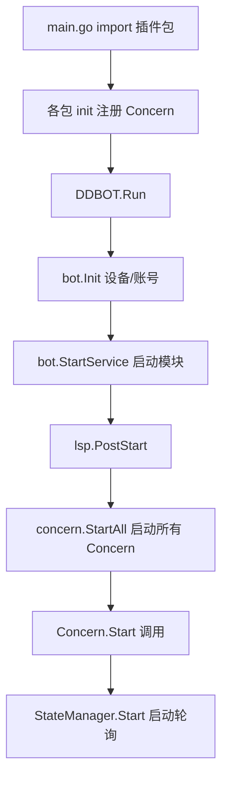

# keyset 与注册

本页讲数据库 key 的规范和 Concern 的注册机制。

---

## 注册 Concern

在插件包的 `init()` 中调用 `RegisterConcern`：

```go
package example

import "github.com/cnxysoft/DDBOT-WSa/lsp/concern"

func init() {
    concern.RegisterConcern(NewConcern(concern.GetNotifyChan()))
}
```

### 注册时会校验

`RegisterConcern` 会检查：

- `Site()` 全局唯一，重复注册会 panic
- 每个 `Type` 的 `IsTrivial()` 必须为 true
- `Types()` 不能为空

### 在 main 中引入

```go
package main

import (
    "github.com/cnxysoft/DDBOT-WSa"
    _ "github.com/yourname/my-plugin/concern"  // 触发 init
)

func main() {
    DDBOT.Run()
}
```

`_` 表示只执行包的 `init()`，不直接引用。引入后插件自动注册。

---

## key 规范

所有插件共用一个 `.lsp.db`，key 需要避免与其他订阅源冲突。

内置订阅源并没有给 key 加 `site` 前缀，而是用不同的 key 名区分。key 生成集中在 `lsp/buntdb/key.go`：

| key 函数 | 生成的 key |
|-----|------|
| `BilibiliUserInfoKey(97505)` | `UserInfo:97505` |
| `TwitterUserInfoKey("elonmusk")` | `TwitterUserInfo:elonmusk` |
| `WeiboUserInfoKey(<id>)` | `WeiboUserInfo:<id>` |

`NamedKey` 用 `:` 把各部分拼起来；自定义插件应选一个不与内置重名的 key 名。

### keyset 文件

`StateManager` 需要一个 `KeySet` 来隔离订阅状态 / 配置的 key，参考 `lsp/bilibili/keyset.go`：

```go
package bilibili

import "github.com/cnxysoft/DDBOT-WSa/lsp/buntdb"

type keySet struct{}

func (k *keySet) GroupAtAllMarkKey(keys ...interface{}) string {
    return buntdb.BilibiliGroupAtAllMarkKey(keys...)
}

func (k *keySet) GroupConcernStateKey(keys ...interface{}) string {
    return buntdb.BilibiliGroupConcernStateKey(keys...)
}

func (k *keySet) GroupConcernConfigKey(keys ...interface{}) string {
    return buntdb.BilibiliGroupConcernConfigKey(keys...)
}

func (k *keySet) FreshKey(keys ...interface{}) string {
    return buntdb.BilibliFreshKey(keys...)
}

func (k *keySet) ParseGroupConcernStateKey(key string) (int64, interface{}, error) {
    return buntdb.ParseConcernStateKeyWithInt64(key)
}
```

`KeySet` 接口要求这 5 个方法齐全（含 `GroupAtAllMarkKey`），缺一个都无法编译通过。自定义 `KeySet` 通过 `NewStateManagerWithCustomKey(Site, keySet, ...)` 传入，见 [StateManager](statemanager.md)。

### extraKey 模式

推特/抖音用 `extraKey` 结构体封装普通数据 key：

```go
// lsp/twitter/extraKey.go
type ExtraKey struct{}

func (e *ExtraKey) UserInfoKey(keys ...interface{}) string {
    return buntdb.TwitterUserInfoKey(keys...)
}
```

然后在 StateManager 嵌入：

```go
type StateManager struct {
    *concern.StateManager
    *ExtraKey
}
```

---

## 内置 key 工具

`lsp/buntdb/key.go` 提供 `Key()` 函数生成标准 key：

```go
import localdb "github.com/cnxysoft/DDBOT-WSa/lsp/buntdb"

key := localdb.Key("OnGroupMemberJoined", groupCode, uin, joinTime)
localdb.Set(key, "", localdb.SetExpireOpt(time.Minute*2))
```

`Key()` 会把各部分用 `:` 拼起来。

---

## 全局 key

部分 key 是框架级的，插件不应使用这些 key 名：

| key 名前缀 | 用途 |
|------|------|
| `Permission` | BOT 管理员 |
| `GroupPermission` | 群管理员（BOT 授予） |
| `GroupEnable` / `GlobalEnable` | 群 / 全局命令开关 |
| `BlockList` | 黑名单 |
| `Version` / `DDBotReleaseKey` | 版本与更新 |

对应 `lsp/buntdb/key.go` 里的 `PermissionKey` / `GroupPermissionKey` / `GroupEnabledKey` / `GlobalEnabledKey` / `BlockListKey` / `VersionKey` / `DDBotReleaseKey`。

---

## 启动顺序



- 各插件的 `init()` 在 import 时执行
- `concern.StartAll()` 在 `PostStart` 时统一启动所有注册的 Concern
- 启动失败的 Concern 会被剔除，不影响其他

---

## 下一步

- [完整范本](example-walkthrough.md) - 真实实现走查
- [Concern 接口](concern-interface.md)
- [配置钩子](config-hook.md)
