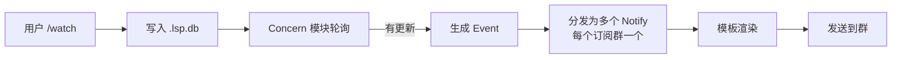

# 订阅源总览

DDBOT-WSa 以 **master** 为准内置 9 个订阅源（B 站、斗鱼、虎牙、ACFun、YouTube、微博、TwitCasting、推特、抖音），覆盖主流直播/动态平台；`next` 不新增订阅源（只扩展现有源的类型/模式），`next-dev` 另有新增的小红书 / Twitch / 小黑盒。也可通过插件扩展任意订阅源。

!!! info "分支差异"
    本页与各订阅源页面以 **master** 为准编写；`master` 内置 9 个订阅源，不含小红书 / Twitch / 小黑盒，ACFun 只有直播、微博只有游客 cookie、推特只有 mirror 模式、抖音只有直播。
    `next` / `next-dev` 的新增内容在各页用 `[next]` / `[next-dev]` 行内标注，完整差异见 [版本与分支](../deploy/branches.md)。

---

## 内置订阅源

| 订阅源 | site | 类型 | 是否需配置 | 说明 |
|--------|------|------|-----------|------|
| [B 站](bilibili.md) | `bilibili` | live / news | 推荐 | 最常用，直播+动态 |
| [斗鱼](douyu.md) | `douyu` | live | 否 | 直播 |
| [虎牙](huya.md) | `huya` | live | 否 | 直播 |
| [ACFun](acfun.md) | `acfun` | live（news 为 `[next]`） | 动态需账号 | 直播；动态（news）`[next]` |
| [YouTube](youtube.md) | `youtube` | live / news | 视情况 | 直播+视频，国内需代理 |
| [微博](weibo.md) | `weibo` | news | 可选 | 动态；`master` 不读取 `mode`（游客 cookie 自动获取），`[next]` 支持 `guest` / `login`，`[next-dev]` 支持 `api` |
| [TwitCasting](twitcasting.md) | `twitcasting` | live | 是 | 直播，需 App 凭证 |
| [推特](twitter.md) | `twitter` | news | 推荐 | nitter 镜像（master / next，代码内置默认镜像，但建议自备可用镜像）；api 模式 `[next-dev]` |
| [抖音](douyin.md) | `douyin` | live（news 为 `[next]`） | 是 | 直播；视频（news）与 `sessionId` `[next]` |
| [小红书](xhs.md) | `xhs` | live / news | 是 | `[next-dev]` 直播 + 图文/视频，需 cookie |
| [Twitch](twitch.md) | `twitch` | live | 是 | `[next-dev]` 直播，需 App 凭证 |
| [小黑盒](xhh.md) | `xhh` | news | 可选 | `[next-dev]` 动态，配置键为 `heybox.*` |

---

## 订阅类型

每个订阅源支持一种或多种 `type`：

| 类型 | 含义 | 适用 |
|------|------|------|
| `live` | 直播状态 | 开播/下播推送 |
| `news` | 动态/内容更新 | B 站动态、ACFun 动态（`[next]`）、微博、YouTube 视频、推特、抖音视频（`[next]`）、小红书笔记（`[next-dev]`）、小黑盒动态（`[next-dev]`） |

不指定 `-t` 时，框架取该订阅源支持类型的**字母序首项**——`concern/registry.go` 的 `ParseRawSiteAndType` 对 `Types()` 结果排序后取第一个，既不是固定 `live`，也不是 `Types()` 的声明顺序。当前各源恰好与下表一致（`live` 的字母序在 `news` 之前）：

| 默认类型 | 订阅源 |
|---------|--------|
| `live` | bilibili、douyu、huya、acfun、youtube、twitcasting、douyin |
| `news` | weibo、twitter |

`[next-dev]` 新增的 twitch、xhs 默认 `live`，xhh 默认 `news`。例如 weibo / twitter / xhh 不写 `-t` 时订阅的是 `news`。

---

## 订阅机制



- **轮询**：轮询间隔来源分两类——`bilibili` / `acfun` / `douyin` / `twitter`（以及 `[next-dev]` 的 `twitch`）读各自的 `<site>.interval`；`douyu` / `huya` / `twitcasting` / `youtube` 与 `master` 的 `weibo` 走全局 `concern.emitInterval`。`[next]` / `[next-dev]` 的 `weibo` 与 `[next-dev]` 的 `xhh`（键为 `heybox.interval`）/ `xhs` 改用 `UseEmitQueueWithSiteInterval`（站点 `interval` → `concern.emitInterval` → 内置 5s）。各源按订阅列表依次轮询
- **去重**：同一更新只推送一次，不会重复
- **限流**：`concern.emitInterval` 控制全局刷新频率，`notify.parallel` 控制并发
- **模板**：每个订阅源有对应的推送模板，可自定义

---

## 通用配置

每个订阅源的推送行为可通过 `/config` 命令定制：

- `at_all` - @全体成员
- `at` - @特定成员
- `title_notify` - 标题变更推送
- `offline_notify` - 下播推送
- `filter` - 动态过滤（B 站）

详见 [配置命令](../commands/config-cmd.md)。

### 停用某个平台（`platform`，`[next-dev]`）

`[next-dev]` 新增的 `platform.<site>.enable` 可整体停用某个订阅源的推送与轮询（Web 管理面板的「平台」页签会写入该键，也可手改 `application.yaml`）：

```yaml
platform:
  xhs:
    enable: false   # 停用小红书；缺省或 true 为启用
```

该键热生效，无需重启；停用后该订阅源不再请求接口、不再产生推送，但订阅记录仍保留（恢复开关后继续轮询）。

---

## 扩展订阅源

DDBOT 是一个通用推送框架，你可以通过编写插件接入任意订阅源：

- 实现 `Concern` 接口
- 在 `init()` 中注册
- 在 `main` 中引入包

详见 [插件开发](../plugin/index.md)。也提供了 [DDBOT-template](https://github.com/Sora233/DDBOT-template) 脚手架和 [DDBOT-example](https://github.com/Sora233/DDBOT-example) 示例。

---

## 下一步

- 选择左侧订阅源查看详细说明
- [订阅命令](../commands/subscribe.md) -- `/watch` 用法
- [推送模板](../template/notify-tmpl.md) -- 自定义推送格式
